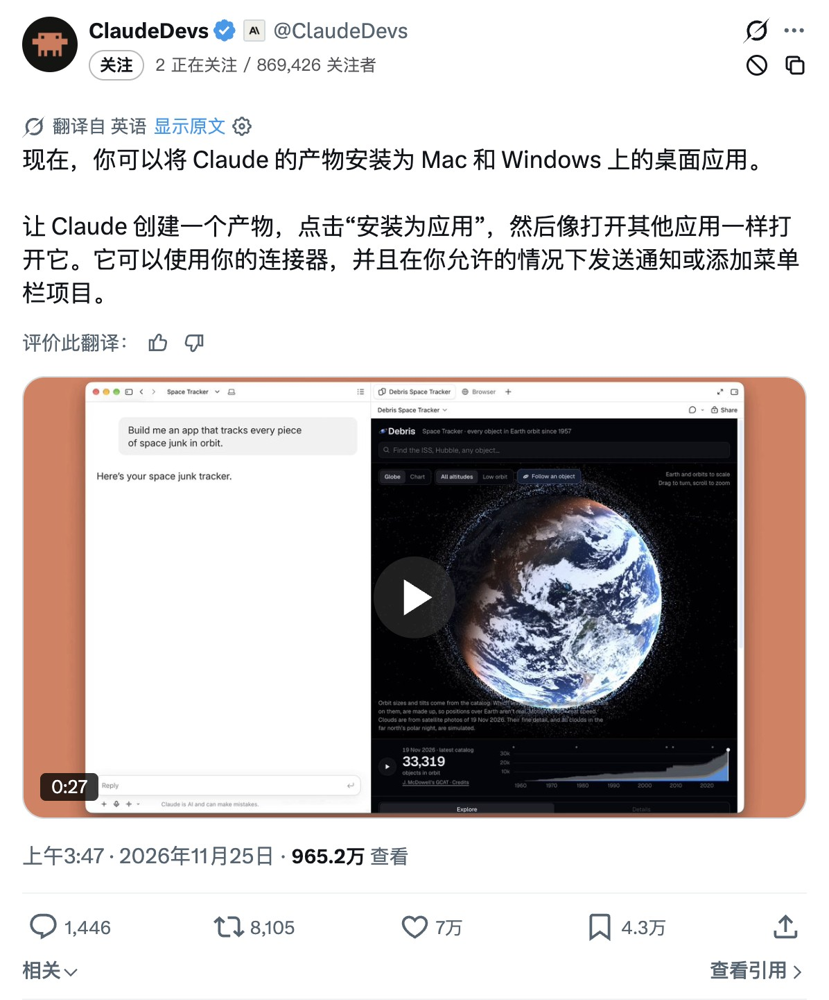

# Make X Great Again

Make X Great Again（MXGA）是一款面向 X（Twitter）网页版的 Chrome 扩展。用 Grok 翻译帖子和回复，复制帖子全文与文章 Markdown，跳过 `t.co` 直开外链。也可以直接在帖子旁关注、取关或屏蔽作者。

[从 Chrome 应用商店安装](https://chromewebstore.google.com/detail/make-x-great-again/hhnjogcifjdjdpjkhfkbhiechbhecpdl) · [从 GitHub 下载 ZIP](https://github.com/yjcdon/make-x-great-again/releases/latest) · [更新日志](CHANGELOG.md)

## 安装

需要 Chrome 111 或以上版本。

在 [Chrome 应用商店](https://chromewebstore.google.com/detail/make-x-great-again/hhnjogcifjdjdpjkhfkbhiechbhecpdl) 点击「添加至 Chrome」。扩展版本以商店详情页为准。

### 手动安装 GitHub 版本

1. 在 [GitHub Release](https://github.com/yjcdon/make-x-great-again/releases/latest) 的 **Assets** 中下载 `make-x-great-again-v*.zip` 并解压。
2. 打开 `chrome://extensions`，开启「开发者模式」。
3. 点击「加载已解压的扩展程序」，选择包含 `manifest.json` 的文件夹。
4. 登录 `x.com`，刷新已打开的 X 网页。

从源码安装时，在第 3 步选择仓库里的 [`extension/`](extension/) 文件夹。

## 帖子快捷操作

在首页、搜索、个人主页、书签和帖子详情等页面，点击「显示翻译」可以用 Grok 翻译正文，也可以切回原文。作者名下显示关注人数和关注或取关按钮，右侧提供复制和屏蔽操作。X 的菜单提供「不感兴趣」等反馈时，也会显示对应的快捷入口。自己的普通帖在 Grok 旁显示复制图标。

## 复制帖子和文章

- **普通帖子。** 点击复制图标，复制当前显示的原文或译文。X 已加载长帖全文时，折叠状态下也能直接复制。完整外链、图片和视频随正文一起复制。
- **X 文章。** 复制为 Markdown，保留标题、段落、列表、引用、代码和链接。封面放在标题后，正文的图片和视频保留在原位置。文章标题下还显示原生的发布时间和查看次数。

图片以 Markdown 图片语法复制，视频使用 X 已提供的 MP4 地址。粘贴到 Typora 后可以直接查看图片、播放视频。复制成功后，图标会短暂显示勾。

## 直开外链

正文、个人简介、相关用户和悬浮资料卡里的外链，在 X 已提供完整网址时可以直接打开。
